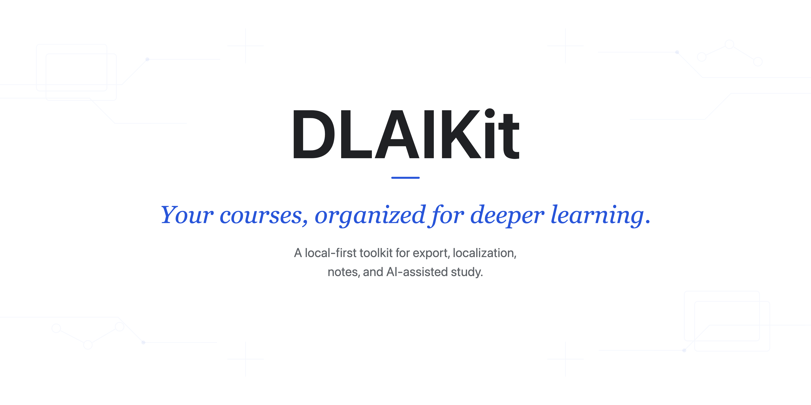

> 中文版本同样可用：[README.md](README.md)。

# DLAIKit


<p align="center">
  
</p>

DLAIKit is an unofficial personal study helper for organizing
DeepLearning.AI course pages that the user is already authorized to access.
This repository does not include or redistribute any DeepLearning.AI or
Coursera course materials; local outputs created by users are the users'
responsibility. The tool uses Playwright to control a local browser for pages
the user is logged in to and authorized to access.

## Legal and Usage Notice

DLAIKit is an unofficial personal study helper. It is not affiliated with,
endorsed by, sponsored by, or officially authorized by DeepLearning.AI or
Coursera. Users should organize only content they are authorized to access and
are responsible for complying with DeepLearning.AI terms, Coursera terms,
course platform terms, lab provider terms, and applicable laws. Do not use this
project to bypass paywalls, login requirements, access controls, or platform
restrictions, and do not publish, share, sell, or redistribute exported
transcripts, notebooks, labs, quizzes, assignments, solutions, or other course
materials without authorization.

See [NOTICE.md](NOTICE.md) for details. If you are a rights holder, or if you
believe this project or related public content harms your rights, contact the
maintainer through GitHub Issues or [ascendho@outlook.com](mailto:ascendho@outlook.com) for prompt review.

## Features

- Discover lessons from course pages the user is logged in to and authorized to access.
- Save lesson transcript Markdown for local personal study.
- Generate a minimal `manifest.json` containing source provenance and extraction status.
- Discover Jupyter/Lab entries from course pages and save accessible code
  locally.
- Use page-provided temporary lab access credentials only within course code,
  project, or graded pages that the user is logged in to and authorized to access.
- Reuse local Playwright login state from `.auth/deeplearning_ai.json`.

## Installation

```sh
python3 -m venv .venv
. .venv/bin/activate
python3 -m pip install --upgrade pip
python3 -m pip install -e ".[dev]"
python3 -m playwright install chromium
```

## Configuration

Edit `dlaikit.json` in the project root:

```json
{
  "course_url": "https://www.deeplearning.ai/courses/building-coding-agents-with-tool-execution",
  "code_url": "",
  "output_dir": "exports",
  "auth_state": ".auth/deeplearning_ai.json",
  "browser_channel": "chrome",
  "browser_profile_dir": ".auth/chrome-profile",
  "browser_visibility": "auto",
  "force": false,
  "skip_code_dirs": ["models"]
}
```

`course_url` is required. DLAIKit automatically discovers current Jupyter/Lab
entries from code, project, and graded lesson pages and downloads accessible
code. `code_url` may remain empty and is only a manual fallback when discovery
fails. Temporary lab URLs can expire and should not be kept in configuration
indefinitely. Confirm that you are authorized to access and locally save the
relevant content before using this feature.

Set `browser_channel` to `"chrome"` to use the installed Google Chrome.
`browser_profile_dir` is a dedicated profile for this project and does not use
or modify your everyday Chrome profile. The default `"chromium"` remains
available on systems without Google Chrome.

Use `skip_code_dirs` to name directories that should not be downloaded. For
example, `["models"]` skips a directory named `models` at any depth, matches
case-insensitively, and does not fetch that directory's children. The default
is an empty list; DLAIKit does not decide which course directories to skip.
Technical directories such as `.git`, `.venv`, `node_modules`, and hidden
directories remain excluded by built-in rules.

Downloaded `.ipynb` files are saved exactly as returned by Jupyter/Lab. DLAIKit
does not start remote kernels, execute notebooks, or modify the remote lab
session.

## Run

In each new terminal session, enter the project root and activate the virtual
environment before running the command:

```sh
cd /path/to/dlai-transcript-extractor
. .venv/bin/activate
dlaikit
```

Alternatively, run `./.venv/bin/dlaikit` directly from the project root without
activating the virtual environment. A `zsh: command not found: dlaikit` error
usually means that `.venv` is not active in the current terminal.

The command generates a clean local export of course resources that are visible
to your authenticated browser and that you are authorized to access. No extra
arguments are needed. With a dedicated Chrome profile, the first run or an
expired login opens Google Chrome. Complete login there and the command
continues automatically. Later runs reuse the profile and run in the background
by default.

## Export Structure

By default, files are exported under `exports/` in the project root:

```text
exports/<course-slug>/
  transcripts/
    01-<lesson-slug>.md
  code/
    lessons/
    project/
  manifest.json
```

- `transcripts/`: official per-lesson transcript text with only a minimal title
  and source wrapper.
- `code/`: accessible code and materials saved from an automatically discovered
  or manually configured fallback Jupyter/Lab entry.
- `code/lessons/`: lesson code from regular code lesson pages or a fallback
  `code_url`.
- `code/project/`: project code from lab entries visible on project, graded, or
  assignment pages; it remains empty when no project lab is found.
- `manifest.json`: minimal source provenance and processing status, without
  generated course summaries, objectives, or instructor lists.

`no_transcript` means the extractor inspected the official page and found no
transcript. Lesson type never excludes transcript extraction up front, so a
video with a code example is still exported normally. Code examples, quizzes,
assignments, and reference pages without transcripts are recorded only in
`manifest.json`; controls and modal text are never saved as transcripts, and
this status does not make the command fail.

The downloader preserves the relative paths and file contents returned by
Jupyter/Lab. It does not deduplicate directories, move shared code, or rewrite
Python/Notebook references. If one Lab appears on both a regular lesson and a
project page, it is saved once under `code/project/`. Download state is stored
under `.auth/code-downloads/`, outside the exported course code.

## Authentication

The extractor does not store usernames or passwords. Under `.auth/`, it stores
a project-only Chrome profile plus a compatibility Playwright state file:

```text
.auth/chrome-profile/
.auth/deeplearning_ai.json
```

Safari cookies cannot be reused by Playwright. Sign in once in the dedicated
Chrome window opened by the project. If the server expires the login or changes
the temporary lab host, the tool opens that profile again. Only add
`"code_token": "your Jupyter token"` or a current `code_url` after confirming
that you are authorized to access the lab and the course page exposes no usable
entry. Do not commit or publish local files containing tokens, login state, or
exported course materials.

If `Start Learning` remains visible after sign-in but `Show Transcript`, `Hide
Transcript`, or a course lab is present, the extractor treats the course content
as authoritative and continues. Temporary network failures are retried; if the
connection still fails, the command stops with a non-zero exit code instead of
reporting every remaining lesson as a separate failure.

## Notes

- This project is intended for personal study workflows.
- Source code lives in `src/dlaikit/`, the import package directory for
  the standard Python `src` layout. It is not an output directory.
- DeepLearning.AI page structure can change; parser tests use local HTML
  fixtures to keep core behavior stable.
