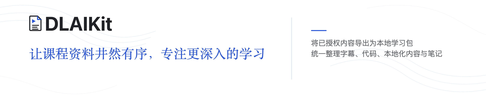

> [English version](README.en.md) is also available.

# DLAIKit


<p align="center">
  
</p>

DLAIKit 是一个非官方个人学习辅助工具，用于把用户已授权访问的 DeepLearning.AI 课程页面整理为本地学习资料。本项目仓库不包含或再分发任何 DeepLearning.AI 或 Coursera 课程材料；用户生成的本地输出由用户自行负责。工具使用 Playwright 控制本地浏览器访问用户已登录且有权访问的页面。

## 使用与法律提示

DLAIKit 是非官方个人学习辅助工具，不隶属于 DeepLearning.AI 或 Coursera，也未获得其官方认可、赞助或授权。使用者应只整理自己有权访问的内容，并自行遵守 DeepLearning.AI、Coursera、课程平台、实验环境提供方的条款以及适用法律。请勿使用本项目绕过付费墙、登录限制、访问控制或平台使用限制，也不要在没有授权的情况下公开发布、分享、出售或再分发导出的字幕、notebook、lab、quiz、assignment、solution 或其他课程资料。

详细说明请阅读 [NOTICE.md](NOTICE.md)。如果你是权利人，或认为本项目及相关公开内容损害了你的权利，可通过 GitHub Issues 或 [ascendho@outlook.com](mailto:ascendho@outlook.com) 联系维护者及时处理。

## 功能

- 从用户已登录且有权访问的课程主页发现 lesson 列表。
- 为本地个人学习保存 lesson 字幕 Markdown。
- 生成最小 `manifest.json`，记录官网来源和提取状态。
- 从课程页面自动发现 Jupyter/Lab 入口并保存可访问的代码到本地。
- 可在用户已登录并有权访问的课程 code、project 或 graded 页面范围内使用页面提供的临时 lab 访问凭据。
- 复用 `.auth/deeplearning_ai.json` 中保存的本地 Playwright 登录态。

## 安装

```sh
python3 -m venv .venv
. .venv/bin/activate
python3 -m pip install --upgrade pip
python3 -m pip install -e ".[dev]"
python3 -m playwright install chromium
```

## 配置

在项目根目录编辑 `dlaikit.json`：

```json
{
  "course_url": "https://www.deeplearning.ai/courses/building-code-agents-with-hugging-face-smolagents",
  "code_url": "",
  "output_dir": "exports",
  "auth_state": ".auth/deeplearning_ai.json",
  "browser_channel": "chrome",
  "browser_profile_dir": ".auth/chrome-profile",
  "browser_visibility": "auto",
  "force": false,
  "skip_code_dirs": ["models"]
}
```

`course_url` 是必填项。DLAIKit 会从 code、project 或 graded lesson 页面自动发现当前可用的 Jupyter/Lab 入口并下载代码；`code_url` 可以留空，只在自动发现失败时作为手工后备入口使用。临时 lab 地址可能过期，不建议长期把旧地址保留在配置中。使用前请确认你有权访问并本地保存相关内容。

`browser_channel` 设为 `"chrome"` 时使用本机 Google Chrome；`browser_profile_dir` 是仅供本项目使用的独立浏览器资料目录，不会占用或修改日常 Chrome profile。默认的 `"chromium"` 仍可用于没有安装 Google Chrome 的环境。

`skip_code_dirs` 用于手动指定不下载的目录名。例如 `["models"]` 会跳过任意层级中名为 `models` 的目录，匹配时不区分大小写，并且不会继续读取该目录的子文件。该配置默认是空列表；DLAIKit 不会自行判断哪些课程目录应该跳过。`.git`、`.venv`、`node_modules` 和隐藏目录等技术目录仍会按内置规则排除。

下载的 `.ipynb` 会按 Jupyter/Lab 返回的原始内容保存。DLAIKit 不会启动远程 kernel、执行 notebook 或修改远程 lab 会话。

## 运行

每次新开终端后，先进入项目根目录并激活虚拟环境，再运行命令：

```sh
cd /path/to/dlai-transcript-extractor
. .venv/bin/activate
dlaikit
```

如果不想激活虚拟环境，也可以在项目根目录直接运行 `./.venv/bin/dlaikit`。
出现 `zsh: command not found: dlaikit` 通常表示当前终端还没有激活 `.venv`。

程序会为你已登录且有权访问的课程资源生成干净的本地导出，不需要额外参数。使用专用 Chrome profile 时，首次运行或登录失效后会打开 Google Chrome；在这个窗口完成登录，程序会自动继续。之后再次运行会复用该 profile，并默认在后台运行。

## 导出结构

默认导出到项目根目录下的 `exports/`：

```text
exports/<course-slug>/
  transcripts/
    01-<lesson-slug>.md
  code/
    <课程原始代码和目录>
  manifest.json
```

- `transcripts/`：官网逐课字幕正文，并附最小标题和来源链接。
- `code/`：从自动发现或手工后备的 Jupyter/Lab 入口保存到本地的可访问代码和资料。
- 只有 lesson 代码或只有 project 代码时，远端目录会直接保存在 `code/`，不会增加只有一层内容的分类目录。
- lesson 和 project 代码同时存在时，才会分别保存在 `code/lessons/` 和 `code/project/`，避免同名文件相互覆盖。
- `manifest.json`：最小来源与处理状态清单，不包含课程摘要、学习目标或讲师归纳。

`no_transcript` 表示程序检查官网页面后确认该课程项没有字幕。课程类型不会用于提前排除字幕，因此同时包含视频和代码示例的 lesson 仍会正常导出 transcript；没有字幕的代码示例、测验、作业和参考页面只记录在 `manifest.json`，也不会因此导致命令失败。

下载器保留 Jupyter/Lab 返回的相对目录和文件内容，不会去重、移动共享目录或改写 Python/Notebook 引用。同一 Lab 同时出现在普通 lesson 和 project 页面时只保存一份，并按 project 处理；如果没有其他 lesson Lab，内容仍直接保存在 `code/`。下载断点状态保存在 `.auth/code-downloads/`，不会混入课程代码目录。

## 登录态

工具不会保存用户名或密码，只在 `.auth/` 下保存复用网页登录所需的项目专用 Chrome profile 和兼容用 Playwright 状态：

```text
.auth/chrome-profile/
.auth/deeplearning_ai.json
```

Safari 的 Cookie 不能直接复用到 Playwright。请在项目打开的专用 Chrome 窗口中登录一次；如果服务端使登录过期或更换临时 lab 主机，程序会再次打开该窗口。只有你确认自己有权访问相关 lab，且课程页面没有提供可用入口时，才应添加 `"code_token": "你的 Jupyter token"` 或当前 `code_url`。不要提交或公开包含 token、登录态或导出课程资料的本地文件。

如果登录后的页面仍显示 `Start Learning`，但已经出现 `Show Transcript`、`Hide Transcript` 或课程 Lab，工具会以课程内容为准并继续抓取。临时断网会自动重试；重试后仍无法连接时，命令会中止并返回非零退出码，避免把剩余所有课节逐一误报为失败。

## 说明

- 本项目面向个人学习工作流。
- 源码位于 `src/dlaikit/`，这是标准 Python `src` layout 下的包目录，不是生成输出目录。
- DeepLearning.AI 页面结构可能变化；解析器测试使用本地 HTML fixture 来保持核心行为稳定。
